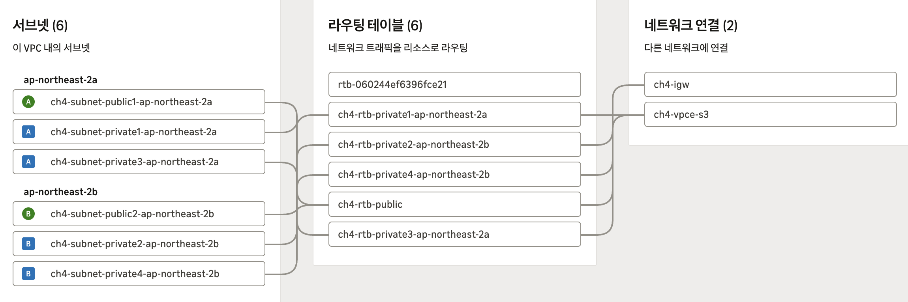
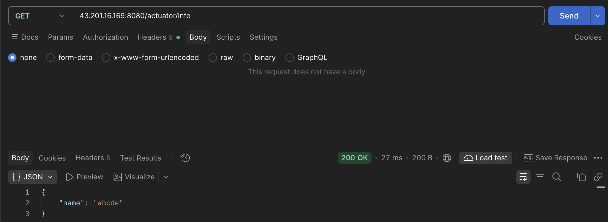
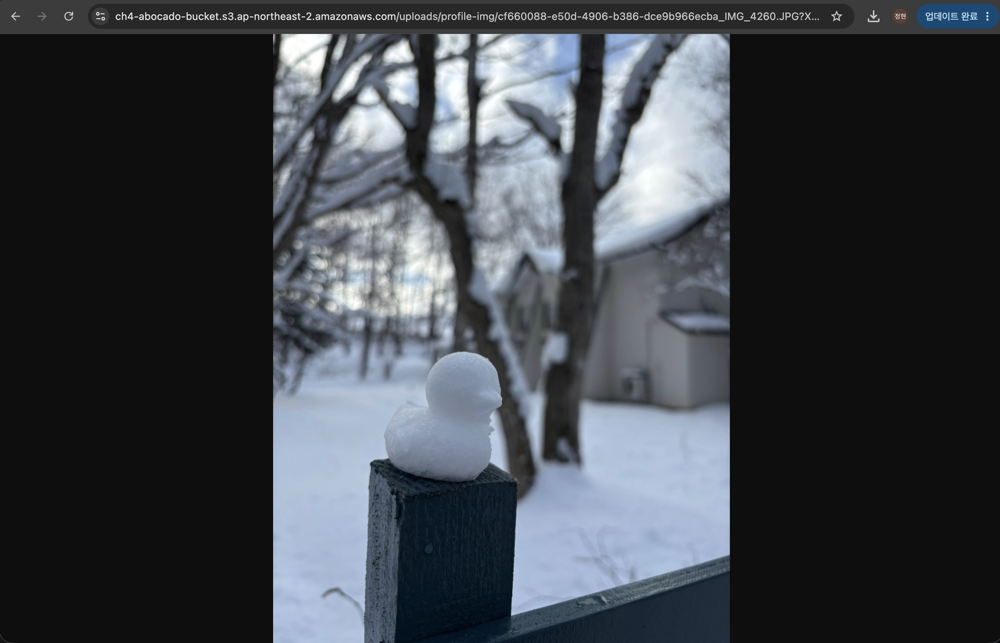

## LV 0 - AWS Budget 설정

 
**리소스 사용으로 인한 과금 방지를 위해 예산 및 알림을 설정하였습니다.**
  - 예산 : $100
  - 알림 : 80% 초과, 100% 초과, 100% 초과 예상

 

## LV 1 - 네트워크 구축 및 핵심 기능 배포

**독립적인 네트워크 환경을 위해 VPC를 설계하고 서브넷을 분리하였습니다**

### [ 📌 제출 ] EC2 퍼블릭 IP : 43.201.16.169 (진행에 따라 없어질 수 있습니다.)

- 서울 리전
  - 주요 서비스 대상 지역이 없는 실습용이라 현재 위치인 서울 리전에 VPC를 생성하였습니다.
  - VPC 사설 IP대역의 경우 10.0.0.0/16 로 기본값으로 잡았습니다.

- AZ
  - AZ 장애 대응 및 초기 기본값 사용으로 2개의 AZ를 선택하였습니다.

- 서브넷
  - 역할에 맞는 분리를 위해 3계층 구조로 각 AZ당 퍼블릭 서브넷 1, 프라이빗 서브넷 2개(App, DB)로 구성하였습니다.
    - 이후 도전 기능(EC2&RDS 이동)에서 VPC를 재사용하기 위해 미리 현재 구조로 구성하였습니다.
    - 현재는 퍼블릭 서브넷에 EC2, DB 인스턴스 모두 포함됩니다.
  - NAT Gateway, ELB 등은 아직 고려하지 않았습니다. (이후 도전기능에서 추가)
  - 서브넷 모두 기본적으로 설정되는 /20의 네트워크 주소를 사용하였습니다.

- EC2
  - t4g.small
    - 비용 대비 성능이 좋은 ARM으로 선택하였습니다.
    - JVM이 메모리를 많이 사용하여 1GB로는 부족할 수 있어 2GB인 t4g.small을 선택하였습니다.
  - 기본 기능에서는 퍼블릭 서브넷에 배치하였고 매핑되는 퍼블릭 IP 자동 할당을 통해 외부 접근을 가능하게 하였습니다.
  - 보안그룹
    - SSH를 현재 위치한 IP주소로 제한하였습니다.
    - TCP 0.0.0.0/0 8080포트를 인바운드 규칙으로 추가하였습니다.

 

## LV 2 - DB 분리 및 보안 연결하기

### RDS 사용

- **샌드박스 템플릿**
  - 단일 AZ에 DB 인스턴스 1개를 생성하였습니다.
- **서브넷 그룹**
  - 이전에 설계한 서브넷 2개를 묶어 DB 인스턴스가 생성될 곳을 지정하였습니다.
- **퍼블릭**
  - 공인 IP를 할당받아 외부에서 접근할 수 있도록 설정하였습니다.
  - 퍼블릭 서브넷에 배치하여 연결된 라우팅 테이블로 DB -> IGW 라우팅을 가능하게 하였습니다.
- **보안 그룹**
  - 우선 로컬 테스트 확인을 위헤 TCP 0.0.0.0/0 3306 포트를 임시 허용하였습니다. (로컬에서 접근 가능 확인)
  - 이후 해당 규칙을 삭제 후, ec2 보안 그룹을 소스로 허용하였습니다. (로컬에서 접근 불가 확인)
    - 공인 IP 또한 회수하였습니다.
- **스키마, 테이블 생성**
  - DB 인스턴스에 스키마와 member 테이블을 넣어주기 위해 로컬에서 SSH터널링으로 EC2를 거쳐서 넣었습니다.

### [ 📌 제출 ] DB 인바운드 규칙

 

### Parameter Store 사용

**DB 접속정보, TEAM_NAME (/actuator/info 확인용) 저장**

- **EC2 IAM ROLE 설정**
  - EC2에서 접근할 수 있도록 SSMReadOnlyAccess를 담은 정책을 Role에 적용하였습니다.

### [ 📌 제출 ] /actuator/info URL

### 🔗 http://43.201.16.169:8080/actuator/info (진행에 따라 없어질 수 있습니다.)

 

## LV 3 - 프로필 사진 기능 추가와 권한 관리

**S3 버킷 생성**
- 로컬(S3Service 동작 확인용), 운영 버킷을 분리하였습니다.
  - 데이터가 섞이는 것을 방지하고, 액세스키가 유출돼도 운영에는 영향이 없게 합니다.
- 버킷 이름은 환경 변수로 주입합니다. (로컬 : IDE, 운영 : parameter store)

**IAM**
- 버킷별로 필요한 최소 권한 (s3:GetObject, s3:PutObject, s3:DeleteObject)만 담은 Policy를 각각 생성하였습니다.
  - 업로드, PreSignedURL발급용, 업데이트 시 기존 이미지 삭제
- 로컬은 IAM User에 로컬 버킷 Policy, 운영은 IAM Role에 운영 버킷 Policy를 적용하여 S3에 접근합니다.
    - 운영의 경우 장기가 아닌 임시 자격 증명을 사용해서 보안성을 높였습니다.

### [ 📌 제출 ] S3 접근 성공 스크린샷
운영에서는 임시 자격증명의 갱신으로 인해 PreSignedURL을 7일간 유지할 수 없어 스크린샷을 첨부했습니다.

**PreSignedURL 취득**

**브라우저에서 접근**

### LV 4 - Docker & CI/CD 파이프라인 구축

**DockerHub**
- 운영과 로컬을 동일한 환경으로 맞추기 위해 도커 이미지 배포를 선택하였습니다.
  - EC2에서 격리된 컨테이너를 띄워 환경 충돌 없이 로컬과 동일한 환경으로 실행됩니다.
- 요구사항에 맞춰 이미지 레포지토리로 DockerHub를 선택하였습니다.
- DockerHub의 토큰을 2개 생성하고 권한을 각각 부여합니다.
  - GitHub Actions -> DockerHub : Read & Write (Write Only는 미존재)
  - EC2 <- DockerHub : Read Only
- GitHub Secrets에 토큰 값을, Variables에 유저명과 저장소명을 저장하고 워크플로우에서 참조합니다.
- 이후 ECR로 교체 예정이라 만료시간을 짧게 잡았습니다.

**GitHub Actions**
- 워크플로우 작성을 통해 CI/CD 파이프라인을 구축합니다.
- CI 파이프라인: push, PR 시 테스트/빌드를 자동으로 수행하여 코드의 안전성을 향상시킵니다.
- CD 파이프라인: ASG의 인스턴스 리프레시를 통한 무중단 배포 예정이라 LV5에서 추가할 예정입니다.
    - 현재는 EC2에서 수동으로 pull해서 가져옵니다.