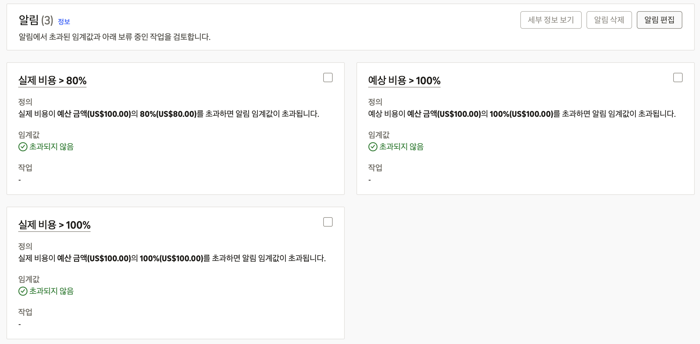

## LV 0 - AWS Budget 설정

 
**리소스 사용으로 인한 과금 방지를 위해 예산 및 알림을 설정하였습니다.**
  - 예산 : $100
  - 알림 : 80% 초과, 100% 초과, 100% 초과 예상

## LV 1 - 네트워크 구축 및 핵심 기능 배포

**독립적인 네트워크 환경을 위해 VPC를 설계하고 서브넷을 분리하였습니다**

### EC2 퍼블릭 IP : 43.201.16.169 (진행에 따라 없어질 수 있습니다.)

- 서울 리전
  - 주요 서비스 대상 지역이 없는 실습용이라 현재 위치인 서울 리전에 VPC를 생성하였습니다.
  - VPC 사설 IP대역의 경우 10.0.0.0/16 로 기본값으로 잡았습니다.
성

- AZ
  - AZ 장애 대응 및 초기 기본값 사용으로 2개의 AZ를 선택하였습니다.

- 서브넷
  - 역할에 맞는 분리를 위해 3계층 구조로 각 AZ당 퍼블릭 서브넷 1, 프라이빗 서브넷 2개(App, DB)로 구성하였습니다.
    - 이후 도전 기능(EC2&RDS 이동)에서 VPC를 재사용하기 위해 미리 현재 구조로 구성하였습니다.
    - 현재는 퍼블릭 서브넷에 EC2, DB 인스턴스 모두 포함됩니다.
  - NAT Gateway, ELB 등은 아직 고려하지 않았습니다. (이후 도전기능에서 추가)
  - 서브넷 모두 기본적으로 설정되는 /20의 네트워크 주소를 사용하였습니다.

- EC2
  - t4g.small
    - 비용 대비 성능이 좋은 ARM으로 선택하였습니다.
    - JVM이 메모리를 많이 사용하여 1GB로는 부족할 수 있어 2GB인 t4g.small을 선택하였습니다.
  - 기본 기능에서는 퍼블릭 서브넷에 배치하였고 매핑되는 퍼블릭 IP 자동 할당을 통해 외부 접근을 가능하게 하였습니다.
  - 보안그룹
    - SSH를 현재 위치한 IP주소로 제한하였습니다.
    - TCP 0.0.0.0/0 8080포트를 인바운드 규칙으로 추가하였습니다.