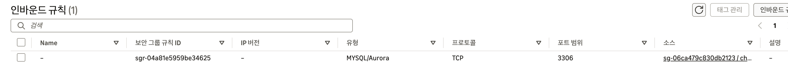
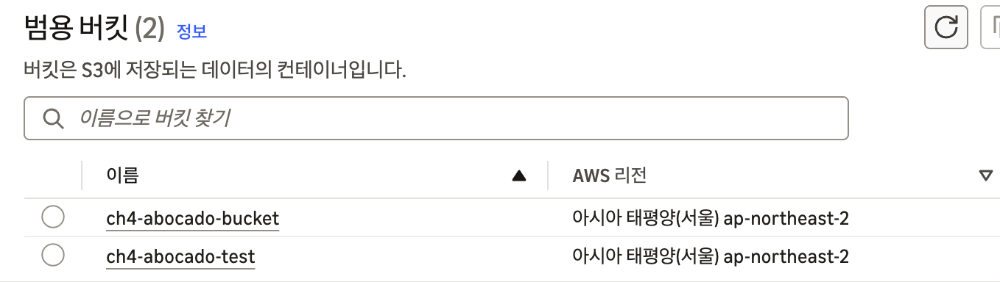
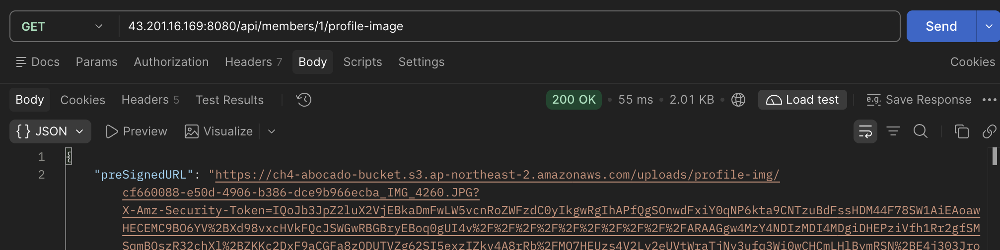
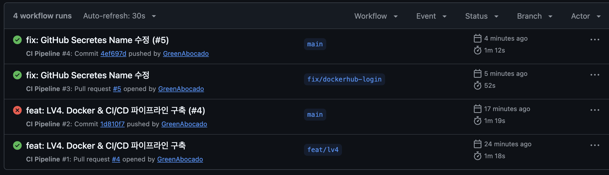
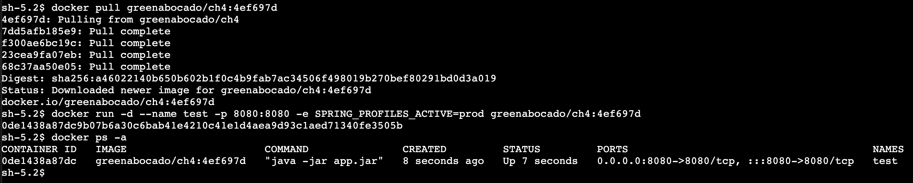
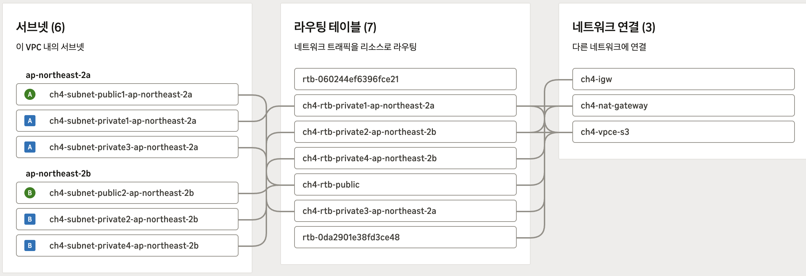
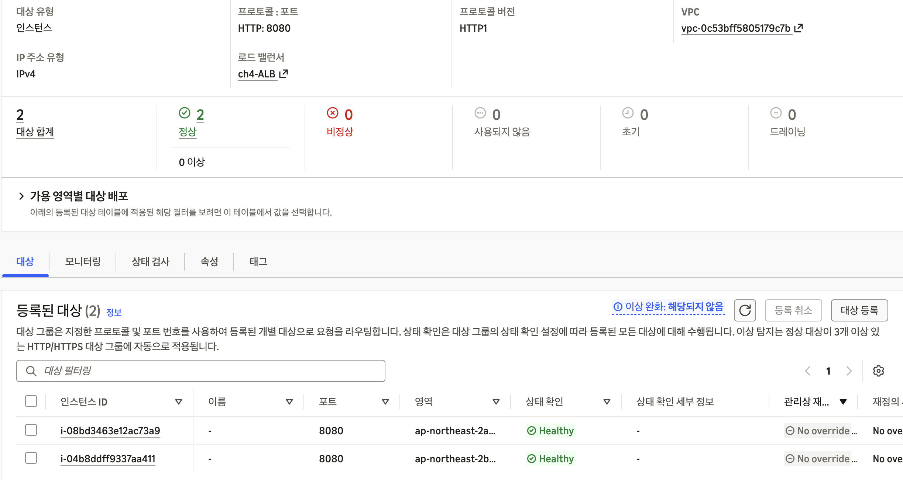

## LV 0 - AWS Budget 설정

 
**리소스 사용으로 인한 과금 방지를 위해 예산 및 알림을 설정하였습니다.**
  - 예산 : $100
  - 알림 : 80% 초과, 100% 초과, 100% 초과 예상

 

## LV 1 - 네트워크 구축 및 핵심 기능 배포

**독립적인 네트워크 환경을 위해 VPC를 설계하고 서브넷을 분리하였습니다**

### [ 📌 제출 ] EC2 퍼블릭 IP : 43.201.16.169 (진행에 따라 없어질 수 있습니다.)

- 서울 리전
  - 주요 서비스 대상 지역이 없는 실습용이라 현재 위치인 서울 리전에 VPC를 생성하였습니다.
  - VPC 사설 IP대역의 경우 10.0.0.0/16 로 기본값으로 잡았습니다.

- AZ
  - AZ 장애 대응 및 초기 기본값 사용으로 2개의 AZ를 선택하였습니다.

- 서브넷
  - 역할에 맞는 분리를 위해 3계층 구조로 각 AZ당 퍼블릭 서브넷 1, 프라이빗 서브넷 2개(App, DB)로 구성하였습니다.
    - 이후 도전 기능(EC2&RDS 이동)에서 VPC를 재사용하기 위해 미리 현재 구조로 구성하였습니다.
    - 현재는 퍼블릭 서브넷에 EC2, DB 인스턴스 모두 포함됩니다.
  - NAT Gateway, ELB 등은 아직 고려하지 않았습니다. (이후 도전기능에서 추가)
  - 서브넷 모두 기본적으로 설정되는 /20의 네트워크 주소를 사용하였습니다.

- EC2
  - t4g.small
    - 비용 대비 성능이 좋은 ARM으로 선택하였습니다.
    - JVM이 메모리를 많이 사용하여 1GB로는 부족할 수 있어 2GB인 t4g.small을 선택하였습니다.
  - 기본 기능에서는 퍼블릭 서브넷에 배치하였고 매핑되는 퍼블릭 IP 자동 할당을 통해 외부 접근을 가능하게 하였습니다.
  - 보안그룹
    - SSH를 현재 위치한 IP주소로 제한하였습니다.
    - TCP 0.0.0.0/0 8080포트를 인바운드 규칙으로 추가하였습니다.

 

## LV 2 - DB 분리 및 보안 연결하기

### RDS 사용

- **샌드박스 템플릿**
  - 단일 AZ에 DB 인스턴스 1개를 생성하였습니다.
- **서브넷 그룹**
  - 이전에 설계한 서브넷 2개를 묶어 DB 인스턴스가 생성될 곳을 지정하였습니다.
- **퍼블릭**
  - 공인 IP를 할당받아 외부에서 접근할 수 있도록 설정하였습니다.
  - 퍼블릭 서브넷에 배치하여 연결된 라우팅 테이블로 DB -> IGW 라우팅을 가능하게 하였습니다.
- **보안 그룹**
  - 우선 로컬 테스트 확인을 위헤 TCP 0.0.0.0/0 3306 포트를 임시 허용하였습니다. (로컬에서 접근 가능 확인)
  - 이후 해당 규칙을 삭제 후, ec2 보안 그룹을 소스로 허용하였습니다. (로컬에서 접근 불가 확인)
    - 공인 IP 또한 회수하였습니다.
- **스키마, 테이블 생성**
  - DB 인스턴스에 스키마와 member 테이블을 넣어주기 위해 로컬에서 SSH터널링으로 EC2를 거쳐서 넣었습니다.

### [ 📌 제출 ] DB 인바운드 규칙

 

### Parameter Store 사용

**DB 접속정보, TEAM_NAME (/actuator/info 확인용) 저장**

- **EC2 IAM ROLE 설정**
  - EC2에서 접근할 수 있도록 SSMReadOnlyAccess를 담은 정책을 Role에 적용하였습니다.

### [ 📌 제출 ] /actuator/info URL

### 🔗 http://43.201.16.169:8080/actuator/info (진행에 따라 없어질 수 있습니다.)

 

## LV 3 - 프로필 사진 기능 추가와 권한 관리

**S3 버킷 생성**
- 로컬(S3Service 동작 확인용), 운영 버킷을 분리하였습니다.
  - 데이터가 섞이는 것을 방지하고, 액세스키가 유출돼도 운영에는 영향이 없게 합니다.
- 버킷 이름은 환경 변수로 주입합니다. (로컬 : IDE, 운영 : parameter store)

**IAM**
- 버킷별로 필요한 최소 권한 (s3:GetObject, s3:PutObject, s3:DeleteObject)만 담은 Policy를 각각 생성하였습니다.
  - 업로드, PreSignedURL발급용, 업데이트 시 기존 이미지 삭제
- 로컬은 IAM User에 로컬 버킷 Policy, 운영은 IAM Role에 운영 버킷 Policy를 적용하여 S3에 접근합니다.
    - 운영의 경우 장기가 아닌 임시 자격 증명을 사용해서 보안성을 높였습니다.

### [ 📌 제출 ] S3 접근 성공 스크린샷
운영에서는 임시 자격증명의 갱신으로 인해 PreSignedURL을 7일간 유지할 수 없어 스크린샷을 첨부했습니다.

**PreSignedURL 취득**

**브라우저에서 접근**

 

### LV 4 - Docker & CI/CD 파이프라인 구축

**DockerHub**
- 운영과 로컬을 동일한 환경으로 맞추기 위해 도커 이미지 배포를 선택하였습니다.
  - EC2에서 격리된 컨테이너를 띄워 환경 충돌 없이 로컬과 동일한 환경으로 실행됩니다.
- 요구사항에 맞춰 이미지 레포지토리로 DockerHub를 선택하였습니다.
- DockerHub의 토큰을 2개 생성하고 권한을 각각 부여합니다.
  - GitHub Actions -> DockerHub : Read & Write (Write Only는 미존재)
  - EC2 <- DockerHub : Read Only
- GitHub Secrets에 토큰 값을, Variables에 유저명과 저장소명을 저장하고 워크플로우에서 참조합니다.
- 이후 ECR로 교체 예정이라 만료시간을 짧게 잡았습니다.

**GitHub Actions**
- 워크플로우 작성을 통해 CI/CD 파이프라인을 구축합니다.
- CI 파이프라인: push, PR 시 테스트/빌드를 자동으로 수행하여 코드의 안전성을 향상시킵니다.
- CD 파이프라인: ASG의 인스턴스 리프레시를 통한 무중단 배포 예정이라 LV5에서 추가할 예정입니다.
    - 현재는 EC2에서 수동으로 pull해서 가져옵니다.

### [ 📌 제출 ] GitHub Actions 워크플로우 정상 수행 & 배포 후 Docker 컨테이너 정상 실행

**GitHub Actions 워크플로우 정상 수행**

CI Pipeline #2의 경우, DockerHub에 로그인 하는 과정에서 오류가 생겼습니다.

GitHub Secrets에 저장한 DockerHub 토큰의 이름(DOCKERHUB_SECRET_KEY)과  
deploy.yaml(워크플로우)에서 사용한 이름(DOCKER_SECRET_KEY)이 달라 생긴 문제였습니다.

새로 브랜치를 파서 수정 후 main에 PR -> merge(push)하는 과정에서 2번의 workflow가 각각 더 수행되었습니다.

**Docker 컨테이너 정상 실행**

DockerHub에 로그인 후 CI 파이프라인을 통해 올려진 이미지를 pull하였습니다.  
이후, 컨테이너를 실행하면서 8080포트와 EC2의 8080포트를 매핑하여 네트워크 통신을 가능하게 하였고  
서버가 운영환경으로 띄워지도록 도커 컨테이너의 환경변수로 SPRING_PROFILES_ACTIVE에 prod를 주입하여줬습니다.

이후 ECR로 전환할 예정이라,  
Docker Hub의 저장소 및 토큰, GitHub Variables/Secrets 등 사용하지 않을 부분들을 제거하였습니다.

 

### DockerHub -> ECR 도커 이미지 저장소 변경

기존 DockerHub의 경우, 토큰 갱신, 유출 대비 등 토큰 관리의 복잡도가 존재했습니다.  
이에 DockerHub에서 AWS ECR로 저장소를 변경하고 인증방식을 OIDC/IAM Role로 변경하였습니다.

이를 통해, 사용자가 토큰을 관리하지 않아도 GitHub이 발급해주는 OIDC 토큰과 AWS의 IAM Role을 통한
임시 자격 증명으로 GitHub Actions에서 간편하게 ECR에 접근할 수 있게 하였습니다.  

또한 EC2, ECR이 같은 AWS 리전 내에 존재하여 내부망으로 통신하므로
DockerHub보다 더 빠르게 이미지를 가져와 배포시간이 단축됩니다.

**OIDC/IAM Role 설정**
- AWS에서 GitHub Actions로부터 OIDC 토큰을 받기 위해 OIDC 공급자에 GitHub Actions를 추가하였습니다.
- IAM Role을 생성하고 신뢰관계 및 권한을 설정하였습니다.
  - 권한에는 AmazonEC2ContainerRegistryPowerUser를 추가하였습니다.
    - 우선 전체적인 구현이 목적이라 실제 권한보다 넓게 잡았습니다.

 

### LV 5 - 고가용성 아키텍처와 보안 도메인 연결 (ALB + ASG + HTTPS)

**NAT Gateway 생성**

이후 프라이빗 서브넷에 놓인 EC2가 ECR 및 Parameter Store에 접근하기 위해  
VPC 밖으로 요청을 보낼 수 있도록 NAT Gateway를 생성하였습니다. (S3의 경우 S3 Endpoint 사용)

- VPC Endpoint보다 구현 복잡도가 낮은 NAT Gateway로 사용하였습니다.
- AZ들에 자동 확장 되는 리전별 NAT Gateway로 생성하였습니다.
- 애플리케이션 계층 서브넷 2개만 라우팅 테이블에 NAT Gateway로의 라우팅을 추가하였습니다.

 

**RDS & EC2 이사**

private1, private2 서브넷을 애플리케이션 계층  
private3, private4 서브넷을 DB 계층으로 정하였습니다.

 

**RDS**

RDS가 프라이빗 서브넷에 DB 인스턴스를 생성해 줄 수 있도록 private 3, 4 서브넷을 그룹으로 묶었습니다.  
이후, 기존 DB의 데이터를 보존하기 위해 스냅샷을 생성한 후 새로 만든 서브넷 그룹을 지정하여 복원하였습니다.

서버에도 반영을 해주기 위해 Parameter Store에다 바뀐 DB 엔드포인트를 업데이트 해주었고  
EC2를 재부팅하여 스프링 구동 시 환경변수를 재주입 받도록 하였습니다.

헬스체크로 정상 작동을 확인하였고 기존 퍼블릭 서브넷 그룹은 삭제하였습니다.

 

**EC2**

- 원격 접속 방법 변경
    - .pem 키 관리를 없애기 위해 SSM 세션 매니저로 접속 방법을 변경하였습니다.
    - EC2 보안 그룹 인바운드 규칙에서 SSH 삭제
    - EC2 IAM Role에 AmazonSSMManagedInstanceCore 추가

- Launch Template 사용
  - 이후 ASG에서도 사용할 예정이므로 미리 만들어서 이번 단계에서도 적용하였습니다.
  - 기존 EC2에서 사용하던 인스턴스 유형 (t4g.small), 보안 그룹, IAM Role을 적용하였습니다.
  - userdata script로 인스턴스 시작 시점에 서버가 자동 시작되도록 하였습니다.
    - 도커 설치 -> 도커 로그인 -> 이미지 pull -> 컨테이너 실행

해당 Launch Template으로 private 1 서브넷에 EC2를 생성하였습니다.  
SSM 세션 매니저로 접속 후 docker ps로 컨테이너 정상 상태 확인하였고 기존 EC2는 삭제하였습니다.

 

**도메인 구입 및 인증서 발급**

- Route 53 도메인 구매
- ACM 인증서 발급
  - 루트 도메인, 1단계 서브 도메인에 대한 인증서를 발급받았습니다.
  - 도메인 소유자 증명 방법으로 DNS 검증을 골랐습니다.

도메인과 ALB의 DNS 매핑 및 ALB 리스너에 인증서 연결은 다음 단계에서 진행합니다.

 

**ALB 및 ASG 구성**

**ALB**

균등한 트래픽 분산 처리를 위해 ALB를 구성합니다.

- 타겟그룹 구성 (헬스체크 엔드포인트를 등록하여 주기적으로 서버 상태를 확인합니다)
- ALB 생성
  - public 1, 2 서브넷에 ALB 노드를 생성합니다.
  - 보안 그룹을 생성하여 적용하였습니다. (HTTP:80, HTTPS:443만 인바운드 허용)
  - 리스너 추가
    - HTTP:80 : HTTPS:443으로 리다이렉트
    - HTTPS:443 : 타겟 그룹으로 분산
  - HTTPS로 요청 시 TLS 인증서 반환하도록 보안 리스너에 추가하였습니다.
- DNS 레코드에 api 서브 도메인과 ALB 리소스를 매핑하였습니다.

 

**ASG**

트래픽에 따른 EC2 스케일링 및 장애 및 배포에 따른 인스턴스 교체를 위해 ASG를 구성합니다.

- 이전에 만들었던 Launch Template을 적용하여 EC2를 생성합니다.
- private 1, 2 서브넷을 지정하여 각 AZ에 균등하게 스케일링되도록 하였습니다.
  - AZ가 2개이므로 초기 크기 2개로 각각 세팅하고 min=2, max=10으로 설정하였습니다.
- 타겟그룹과 연결하여 스케일링 대상이 타겟 그룹에 포함되어 로드 밸런싱 대상이 되도록 설정하였습니다.

### [ 📌 제출 ] URL & 타겟 그룹 이미지

### 🔗 https://api.abocado.click

### 타겟 그룹

 

### LV 6 - 글로벌 성능 최적화 (CloudFront CDN)

빠른 프로필 사진 로딩을 위해 분산된 Edge Location에 이미지를 캐싱합니다.

- 기존 S3 버킷을 오리진으로 등록하여 캐싱되어있지 않을 때 S3에서 가져옵니다.
- CloudFront 배포 생성 중 Route 53 도메인 연결 및 인증서 발급을 수행합니다.

### [ 📌 제출 ] CloudFront 이미지 URL

### 🔗 https://static.abocado.click/uploads/profile-img/ea0cac46-4f57-4de7-9e1f-bf5d28cbf128_IMG_4260.JPG
(업로드한 프로필 이미지 중 하나)